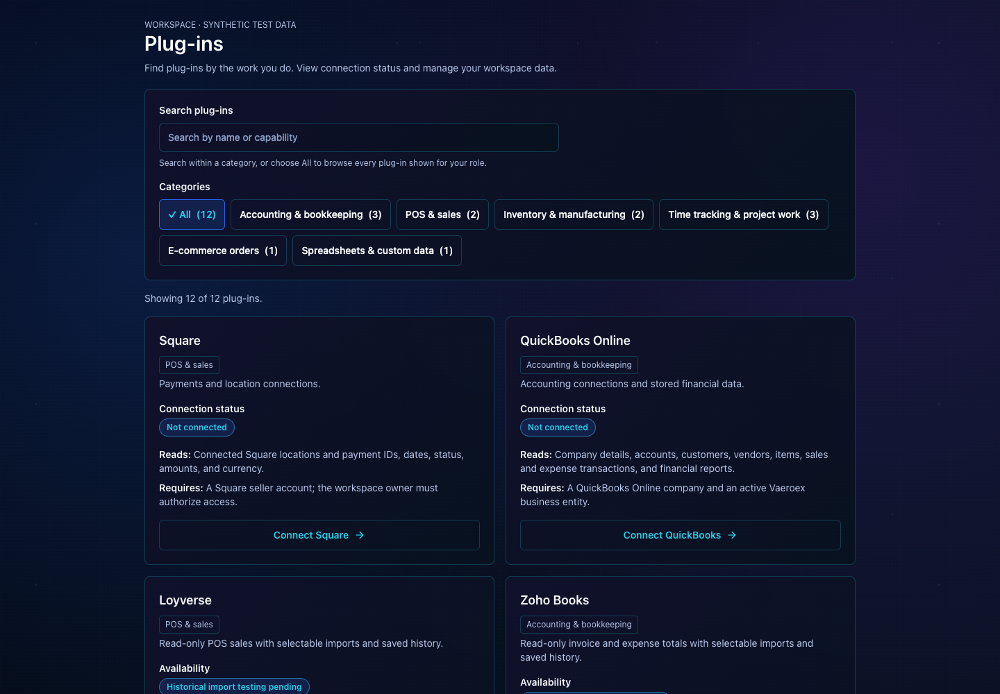
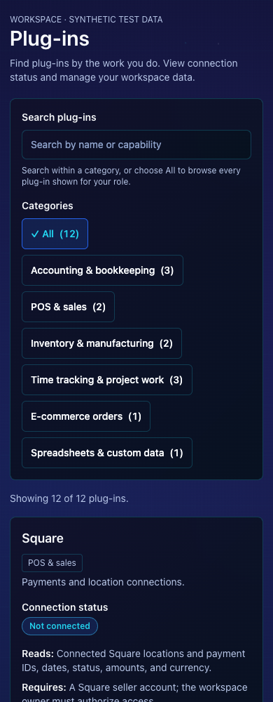
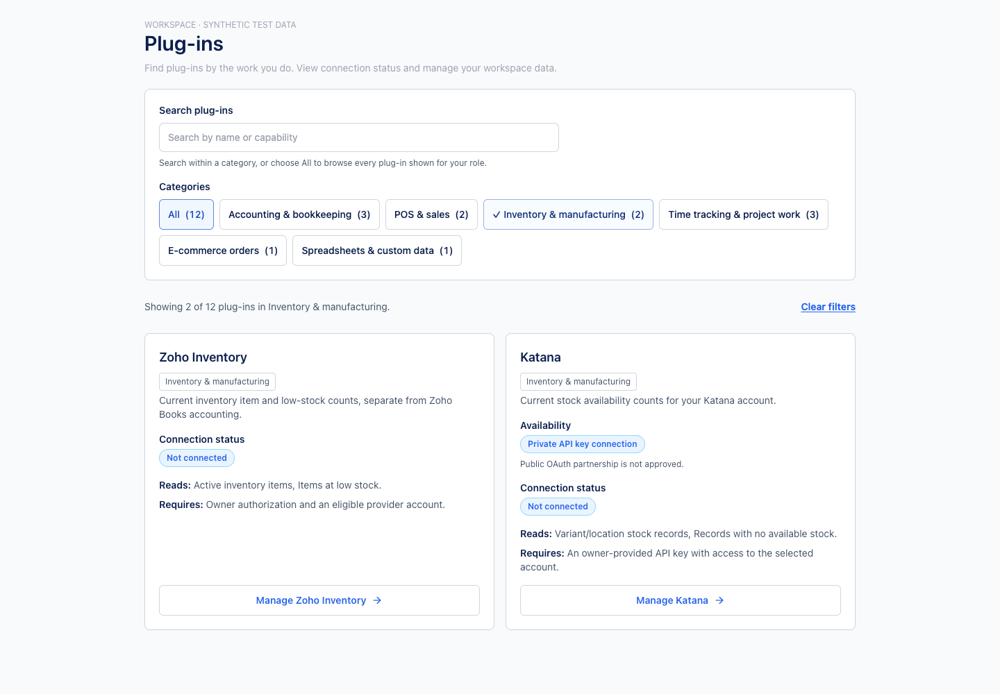
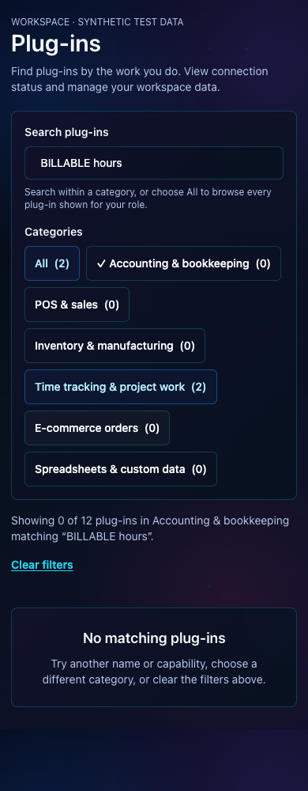

# Workspace Plug-ins catalog verification

The authenticated `/app/integrations` catalog now supports capability categories,
search within the selected category, matching counts, and a clear-filter empty
state. Cards remain a two-column desktop / one-column mobile grid in the existing
workspace theme. Native buttons expose their selected state with `aria-pressed`
and a visible checkmark; result counts are announced, and resetting returns focus
to search.

Categories describe the connector's implemented reads, not the provider's full
product suite. No payroll, scheduling, reservation, or paused-provider cards were
added. Existing role and configuration gates determine which cards are included.
Setup, pilot, private-key, sandbox, and pending historical-import qualification
labels remain distinct from connection status. Wix unlisted access does not imply
public App Market approval.

## Local verification on Isaac's Mac

- `pnpm test:plugin-catalog` plus `node --test scripts/square-direct-customer-ui-tests.js`: 56 tests passed across the combined run. Coverage includes category/search intersections, blank queries, punctuation and case, role/configuration gates, connection errors, pending authorization, all card destinations, and Square connection/recovery/disconnect controls.
- `pnpm test:plugin-import-history`: 59 tests passed.
- `pnpm test:plugin-catalog:browser`: passed with local Chrome at 1440, 768, 390, and 320 pixels. Checks include one/two-column layout, no horizontal overflow, search-dependent counts, empty/reset state, Tab/Enter/Space interaction, focus restoration, and every management/upload destination after filtering.
- `pnpm test:plugin-import-history:browser`: all three suites passed at 1280, 390, and 320 pixels. They cover import consent, selected dates, saved-history filters, owner/member controls, gaps, legacy fallback, and error states.
- `node scripts/integrations-ui-browser-tests.js`: passed at 1440, 390, and 320 pixels, including Settings → Plug-ins → QuickBooks management → Plug-ins navigation.
- `pnpm typecheck`, focused ESLint, and `git diff --check`: passed.
- `pnpm build`: passed, including production compilation, type validation, and route generation (existing repository lint warnings remain).

Review follow-up: long unbroken queries previously overflowed the result summary
inside the workspace's clipped layout. The summary now wraps those words, and
the browser suite checks the element's own scroll width at every tested viewport.

These are **synthetic local browser fixtures**, using the production catalog
controls, server-rendered cards, and workspace CSS. They do not use customer data,
provider credentials, or live OAuth/sync/disconnect calls. They do not establish
production availability or replace the outstanding live testing for Books,
Loyverse, and Wix historical imports.

To reproduce on macOS, set `QBO_TEST_CHROME_EXECUTABLE` to the installed Chrome
binary for the catalog/history scripts; the existing integration navigation script
uses `INTEGRATIONS_TEST_CHROME_EXECUTABLE`. By default the scripts use Playwright's
installed Chromium. The catalog screenshot directory can be overridden with
`PLUGIN_CATALOG_SCREENSHOTS`. For manual local inspection, run
`PLUGIN_CATALOG_SERVE=1 PLUGIN_CATALOG_PORT=4319 pnpm test:plugin-catalog:browser`.

## Screenshots

Desktop overview (Pulsar):

Mobile overview (390 px):

Filtered inventory cards (light theme, including Katana availability):

Combined search/category empty state:

